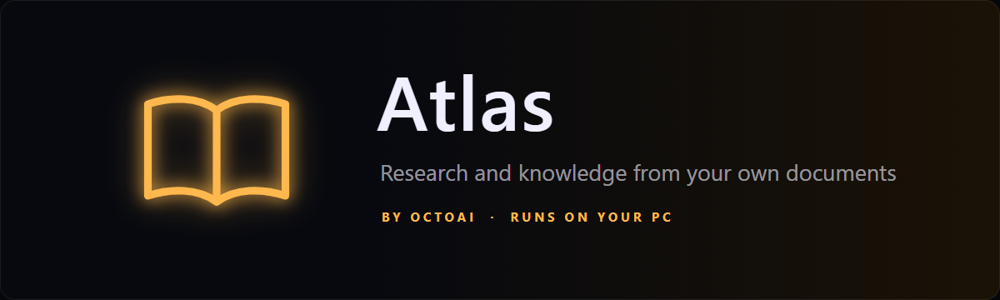

<p align="center">
  
</p>

<p align="center">
  <a href="https://github.com/Khan-Doruk/atlas-releases/releases/latest"></a>
  <a href="https://github.com/Khan-Doruk/atlas-releases/releases"></a>
  
  
</p>

<p align="center">
  <a href="https://github.com/Khan-Doruk/atlas-releases/releases/latest/download/AtlasSetup.exe"><b>Download Atlas for Windows</b></a>
  &nbsp;·&nbsp;
  <a href="https://github.com/Khan-Doruk/atlas-releases/releases">Release notes</a>
  &nbsp;·&nbsp;
  <a href="https://ai.octoman.io">ai.octoman.io</a>
</p>

---

Atlas reads your documents and answers questions about them. Drop in papers and notes, ask, and every answer quotes the passages it comes from, with the page. Compare documents, find new papers, keep a notebook and study with quizzes and flashcards. The AI runs on your own machine through [Ollama](https://ollama.com), so your documents stay with you.

## What Atlas does

| | |
|---|---|
| **Answers from your documents** | Drop PDFs, Word files, Markdown or text on the window and ask about them. Every answer quotes its sources with the page, and the quotes are checked against the document. |
| **Opens the page** | Click a quote and the reader slides in at that page with the words highlighted. |
| **Compares documents** | Ask how two papers differ or what they agree on, and get the answer across both, with a table when it helps. |
| **Search by meaning** | Find passages by what you mean, not only the exact words. |
| **New papers** | "Papers on tinyML" searches Semantic Scholar (and OpenAlex when it's busy). Load a result straight into your library. |
| **Notebook and references** | Save answers to your notebook, export it, and get references for your documents in APA or BibTeX. |
| **Study** | "Quiz me" or "flashcards for" a document, made from its own text. |
| **Talk to him** | Press `Ctrl+Shift+A` or click the mic and just talk. He answers out loud. He also remembers what you ask him to. |
| **Works with Orion** | With [Orion](https://github.com/Khan-Doruk/orion-releases) on the same PC, he can ask Atlas what your documents say. |

### Try saying

```text
What does this paper say about battery life?
Compare the two papers
Papers on tinyML
Load paper 2
Quiz me on paper_A.pdf
Cite these as BibTeX
Save that to my notebook
```

## Getting started

1. **Download** [`AtlasSetup.exe`](https://github.com/Khan-Doruk/atlas-releases/releases/latest/download/AtlasSetup.exe) and run it. No administrator rights needed.
2. If Windows shows **"Windows protected your PC"**, click **More info**, then **Run anyway**. The installer isn't code-signed yet.
3. Setup installs **Ollama**, the local AI engine, if it's missing or out of date (about 1.6 GB). If you have Orion, Atlas uses the same one.
4. On first start, enter your **product key**. Atlas is in testing with a small group, and keys are handed out to testers.
5. Atlas gets ready: he downloads a small model for searching by meaning (about 0.3 GB) and an AI model for his answers unless your PC already has one from Orion. This happens once.

## Requirements

| | |
|---|---|
| **System** | Windows 10 or 11, 64-bit |
| **Graphics card** | An NVIDIA card with 8 GB of memory gives the best answers and the fastest hearing. Smaller cards, and PCs without one, get a smaller model and run slower. |
| **Disk space** | About 12 GB (Atlas, Ollama and the largest answer model together); about 2 GB more if Orion is already installed |
| **Microphone** | Optional. You can type everything too. |
| **Internet** | For setup and the model downloads. After that Atlas answers from your documents offline; finding papers and web search need a connection. |

**Which answer model you get**

| Graphics memory | Model | Download |
|---|---|---|
| 8 GB or more | qwen3.5:9b | about 6.6 GB |
| 4 to 8 GB | qwen3.5:4b | about 3.3 GB |
| Less, or no NVIDIA card | qwen3.5:2b | about 2.7 GB |

If Orion already downloaded one, Atlas uses that.

## Privacy

- **Your documents stay on your PC.** They are read and searched by the models on your machine, not by a cloud service.
- **Your voice stays local.** Speech is turned into text on your PC; no recordings are uploaded.
- **Online only for what you use.** Finding papers (Semantic Scholar, OpenAlex), web search when no document is loaded (it can be turned off in Settings), the model downloads, and the update check on this page.
- **You're in control of memory.** Everything Atlas remembers is listed in Settings, with a forget button for each item.

## Updates

Atlas checks this page for new versions and shows a bar with **Install**, **What's new** and **Later**. Every update is checked against a signed list of file hashes before it installs, and it keeps your library, notebook, activation and models. Say **"check for updates"** any time.

### Check your download

Each release includes `SHA256SUMS.txt`. In PowerShell, in the folder you downloaded to:

```powershell
Get-FileHash .\AtlasSetup.exe -Algorithm SHA256
```

The hash should match the line for `AtlasSetup.exe` in `SHA256SUMS.txt`.

## Help

- **Something not working?** Open **SETTINGS, SETUP, CHECK MY SETUP**. It tests his voice, hearing, document reading, search and AI in one go. **COPY REPORT** gives you a text to send along; it contains no personal data.
- **Shortcut:** `Ctrl+Shift+A` brings Atlas up and starts a conversation.
- **Language:** Atlas understands and speaks English.
- **Uninstalling:** Windows Settings, Apps, Atlas. This removes Atlas and his data, including his library and notebook. It asks before removing Ollama and its models, and suggests keeping them while Orion or Iris still use them.

---

<p align="center">
  This repository holds Atlas's installers and release notes only.<br>
  Atlas is made by <a href="https://ai.octoman.io">OctoAI</a>, the AI division of <a href="https://octoman.io">Octoman</a>.
</p>
